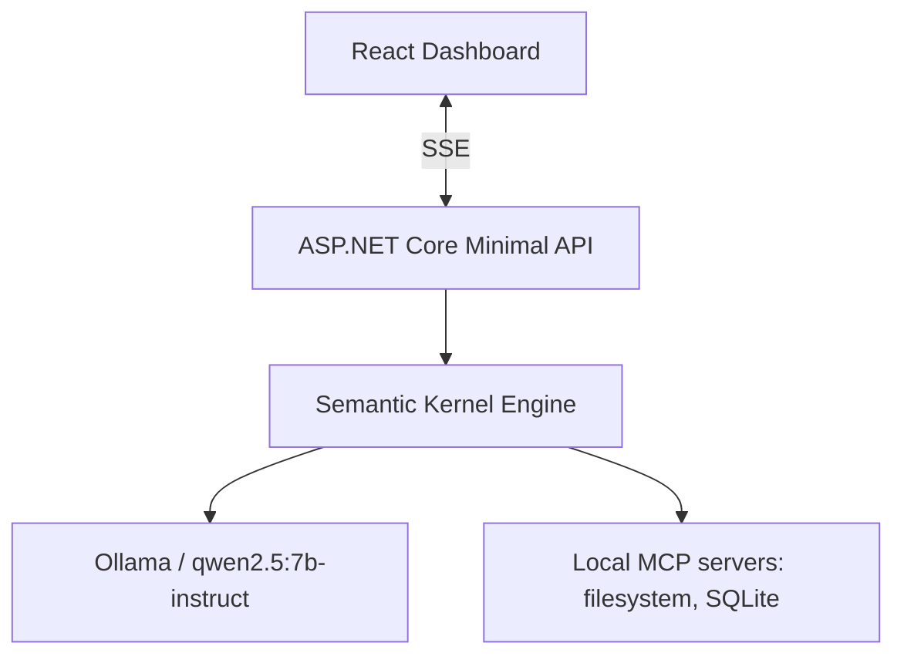

# Local Knowledge & File Assistant

Single-agent ReAct loop with tool calling over local MCP servers, running against a local Ollama model.



## Layout

| Path | Purpose |
|---|---|
| `src/Assistant.Core` | Agent loop, LLM abstraction, tool registry, MCP wiring (Semantic Kernel) |
| `src/Assistant.Api` | Minimal API, DI composition, SSE endpoint `/api/chat` |
| `src/Assistant.SqliteMcp` | Our own read-only SQLite MCP server (stdio), launched by the API |
| `data/` | SQL migrations (`data/migrations`) and the generated metadata database (git-ignored) |
| `tests/Assistant.Tests` | xUnit tests (agent loop, tool validation, indexer, read-only SQL server) |
| `web` | React + TypeScript + Vite + Tailwind v4 dashboard |
| `docs/` | Architecture (TAD), roadmap, and specs for prompts, MCP, data, API, security and operations; see [docs/README.md](docs/README.md) |

## Run

```
ollama pull qwen2.5:7b-instruct
.\scripts\ollama-start.ps1
dotnet run --project src/Assistant.Api --urls http://localhost:5080
cd web && npm run dev
```

`scripts/ollama-start.ps1` starts `ollama serve` in the background, waits until it answers on `http://127.0.0.1:11434` and warns if the model is not pulled; it does nothing if Ollama is already running. `scripts/ollama-stop.ps1` stops the server, its model runners and the tray app. If script execution is blocked, run them with `powershell -ExecutionPolicy Bypass -File scripts\ollama-start.ps1`.

Targets .NET 10 (the installed runtime) rather than .NET 9.

## Roadmap

Work is planned in seven phases (0-6), each broken into stages: scaffold, streaming chat, MCP filesystem tools, ReAct loop with validation, SQLite metadata, dashboard UI, and hardening. Phases 0-3 (scaffold, streaming chat, MCP filesystem tools, ReAct loop with validation) are done. Phase 4 (SQLite metadata) is in progress: the schema, the incremental indexer, the read-only SQLite MCP server and tool selection between filesystem and SQLite are built; combined scenarios (4.5) are next.

See the full plan in [docs/ROADMAP.md](docs/ROADMAP.md). Architecture details are in [docs/TAD.md](docs/TAD.md).
