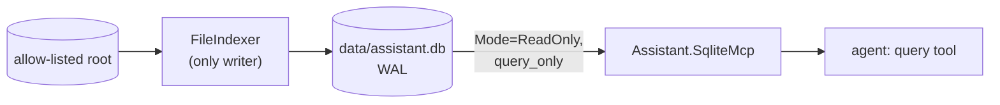
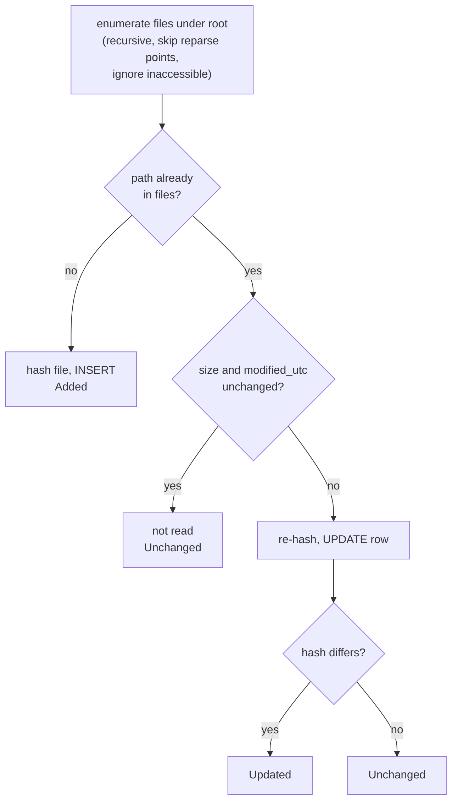

# Data Architecture and Indexing Specification

**Status:** Describes the metadata database and indexer as built (ROADMAP Phase 4.1 and 4.2). Tags and summaries have a schema but nothing writes to them yet. Items marked *(planned)* are not built.

Overview: [TAD.md](TAD.md) section 5.5. How the model queries this data: [MCP-SPEC.md](MCP-SPEC.md) section 6.

## 1. Purpose

A SQLite database (`data/assistant.db`) describes the files under the allow-listed document root, so questions about files as items (names, sizes, dates, counts) are answered with one query instead of reading every file. It holds metadata only, never file contents.

**Ownership rule:** the indexer (`FileIndexer`, run by `IndexingService`) is the only writer. The agent reaches the database only through `Assistant.SqliteMcp`, which opens it read-only. `data/*.db*` is generated and git-ignored.

## 2. Schema

Defined in `data/migrations/001_init.sql`. Foreign keys are on for every indexer connection.

### `files`

| Column | Type | Notes |
|---|---|---|
| `id` | INTEGER PK | |
| `path` | TEXT, unique, not null | Absolute path exactly as the filesystem tools expect it |
| `name` | TEXT, not null | File name including extension |
| `extension` | TEXT, not null | Lower-case with the leading dot, or empty |
| `size_bytes` | INTEGER, not null | |
| `modified_utc` | TEXT, not null | ISO 8601 round-trip format, for example `2026-10-08T21:14:31.2846206Z` |
| `hash` | TEXT, not null | SHA-256, lower-case hex |
| `indexed_utc` | TEXT, not null | When the row was last written by a scan |

Indexes: `ix_files_modified (modified_utc)`, `ix_files_extension (extension)`.

**Timestamp caveat.** `modified_utc` and `indexed_utc` are ISO text with a `T` and a `Z`. They sort correctly as text against each other, but not against SQLite's `datetime('now')`, which uses a space and no zone. Queries that compare to "now" must wrap the column: `datetime(modified_utc) >= datetime('now', '-7 days')`. The system prompt teaches this, and a test pins it.

### `tags`, `file_tags`, `summaries`

| Table | Columns | Notes |
|---|---|---|
| `tags` | `id`, `name` (unique, `COLLATE NOCASE`) | Empty today |
| `file_tags` | `file_id` to `files` (cascade), `tag_id` to `tags` (cascade); PK is the pair | Empty today |
| `summaries` | `file_id` PK to `files` (cascade), `summary`, `source_hash`, `generated_utc` | Empty today. `source_hash` is the file hash the summary was written for; it is stale when it differs from `files.hash` |

Deleting a file row cascades to its tag links and summary.

## 3. Migrations

- Files live in `data/migrations/NNN_description.sql` and are embedded into `Assistant.Core` as resources named `migrations/...`.
- `MetadataDatabase.Migrate()` creates the directory and database if needed, switches to WAL, then applies each migration whose number is greater than SQLite's `PRAGMA user_version`, in order, each in its own transaction that also sets `user_version`. It is safe to call repeatedly.
- A resource not named `NNN_description.sql`, or two with the same number, throws `InvalidOperationException` (the service logs it and turns indexing off).

**Adding a migration**

1. Create `data/migrations/00N_what_changed.sql` with the next number. Never edit a shipped migration; databases already at that version will not re-run it.
2. Keep it additive where you can. SQLite cannot drop or retype a column in place, so a destructive change means a new table and a copy, in one migration.
3. If the `files` table changes, update the system prompt and bump its version ([PROMPT-SPEC.md](PROMPT-SPEC.md) section 2); the drift test fails otherwise.
4. Add or extend tests; coverage stays at 100%.

There are no down migrations. Because the database is derived data, the recovery path is to delete `data/assistant.db*` (the `.db`, `-wal` and `-shm` files) with the API stopped and let the next start rebuild it.

## 4. Incremental indexing

`FileIndexer.Index(root, ct)` runs in a single transaction and returns `IndexResult(Added, Updated, Unchanged, Removed, Skipped)`.

| Rule | Detail |
|---|---|
| Change detection | Size plus modified time first, so an untouched file is never read. A changed time forces a re-hash, and the file counts as `Updated` only if the content hash differs (a `touch` is not an update, though the row's time and `indexed_utc` are refreshed) |
| Deletions | Rows whose path was not seen in this scan are deleted (`Removed`), cascading to tags and summaries |
| Locked or vanished files | `IOException` and `UnauthorizedAccessException` are logged, counted as `Skipped`, and the existing row is left alone, so a file locked during a scan is not wrongly removed. The row is picked up next scan |
| Symlinks and junctions | Reparse points are skipped, so the scan cannot be led outside the root through a link |
| Hashing | SHA-256, opened with `FileShare.ReadWrite` and `FileShare.Delete` so a file being written elsewhere can still be read |
| Atomicity | One transaction per scan: a scan that throws leaves the database as it was |
| Root missing | `DirectoryNotFoundException`; the service logs it and retries next interval |

Files are matched by exact `path` (ordinal comparison), so a rename is a delete plus an add.

## 5. Synchronisation and scheduling

`IndexingService` is a `BackgroundService`:

1. If `Indexing:Enabled` is false it logs and exits.
2. `Migrate()`; on failure it logs an error and exits, leaving indexing off for the rest of the process.
3. Loop: run `FileIndexer.Index` on a worker thread, log the `IndexResult`, then wait `Indexing:IntervalMinutes`. Interval 0 scans once at startup and stops.
4. A scan failure is logged and retried on the next interval. Shutdown cancels the scan and the wait.

There is no file-system watcher; the index can lag the disk by up to one interval (default 5 minutes). The system prompt tells the model to fall back to `list_directory` and `search_files` when a file it expects is missing from the index.

Concurrency: WAL lets `Assistant.SqliteMcp` read while a scan writes. Readers see the last committed scan, never a half-finished one.

### Configuration (`Indexing` section, validated at startup)

| Key | Default | Meaning |
|---|---|---|
| `Enabled` | `true` | Turn the background indexer off (tests set it to false) |
| `Root` | required | Directory to scan. **Keep equal to the filesystem MCP server's allow-listed root**, by hand; they are not linked |
| `DatabasePath` | required | SQLite file. Relative paths resolve against the working directory |
| `IntervalMinutes` | 5 | 0 to 1440; 0 means scan once |

## 6. Retention and cleanup

| Data | Policy |
|---|---|
| `files` rows | Mirror the disk; removed on the next scan after the file disappears |
| Tags and summaries | Removed with their file (cascade). Summaries older than their file's current hash are stale by definition *(planned: nothing generates or prunes them yet)* |
| Database file | No size cap or vacuum. Rebuildable at any time by deleting `data/assistant.db*` with the API stopped |
| Conversation history | Not persisted (TAD section 1) |

## 7. Not built *(planned)*

- Populating `tags` and `summaries`.
- File-system watching instead of interval polling.
- Content indexing or full-text search. Content questions go through the filesystem read tools.
