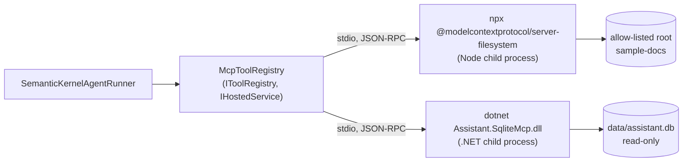

# MCP Integration Specification

**Status:** Describes current behaviour. The watchdog and restart items in section 6 are *(planned)* and not built.

Defines the contract between the core engine and the local MCP servers. Overview: [TAD.md](TAD.md) section 5.4. Security reasoning: [SECURITY.md](SECURITY.md).

## 1. What we do and do not define

The wire protocol is the Model Context Protocol over stdio, implemented by the official C# SDK (`ModelContextProtocol` 2.x) on both sides. We define **no custom JSON-RPC messages**. `initialize`, `tools/list` and `tools/call` are the standard methods. What this project owns is:

- which servers are launched and how (configuration),
- which of their tools the model may see (`ExcludeTools`),
- how tool calls are validated and results normalised before and after the call,
- the contract of our own server, `Assistant.SqliteMcp`.

## 2. Topology

One `McpClient` per server is created at startup and shared by every request; the SDK multiplexes JSON-RPC over it. It has not been load-tested under concurrent chats.

## 3. Server configuration

Config section `Mcp:Servers` (`McpServerOptions`, `McpServerDefinition`):

| Field | Meaning |
|---|---|
| `Name` | Server name. Becomes the Semantic Kernel plugin name, so the prefix of every tool name (`sqlite_query`) |
| `Command` | Executable to launch (`npx`, `dotnet`) |
| `Args` | Arguments. The token `{BaseDirectory}` expands to the app's base directory (with trailing separator); this is how the API finds `Assistant.SqliteMcp.dll` beside it |
| `ExcludeTools` | Tool names withheld from the model, matched case-insensitively. Used to keep the agent read-only and the tool set small |

Adding a server is a new entry here, not a code change. If its tools can write, list them in `ExcludeTools`.

Relative paths in `Args` resolve against the API's working directory; see [RUNBOOK.md](RUNBOOK.md) section 2.

## 4. Process lifecycle (current)

1. `McpToolRegistry.StartAsync` runs at host start. For each configured server, in order, it creates a `StdioClientTransport`, connects, and calls `tools/list`. Connect and list share a 30 second timeout per server.
2. `ExcludeTools` is applied; the remaining tools are stored per server name.
3. On each agent run, `RegisterAsync` adds each server's tools to the run's kernel as a plugin (skipping a plugin that is already present).
4. On shutdown `DisposeAsync` disposes every client, which ends the child processes.

Failure handling:

| Situation | Behaviour |
|---|---|
| Server fails to start or times out at startup | Logged at error (`MCP server {Server} failed to start; its tools are unavailable`); skipped; the app stays up without those tools |
| Server dies after startup | Not detected. Tool calls fail and come back to the model as error results until the app restarts |
| Tool call throws | `SemanticKernelAgentRunner.ExecuteAsync` turns it into an error `ToolResultEvent` (`Tool '<name>' failed: <message>`) |
| Run cancelled or timed out during a call | `OperationCanceledException` is rethrown when the caller's token is cancelled; a run timeout ends the run with an `ErrorEvent` |

SqliteMcp writes protocol on **stdout**, so all of its logging goes to **stderr**. Never write to stdout from that process.

## 5. Tool-call contract

Every model-requested call passes `ToolCallValidator` before it reaches a server. Validation never throws on bad model output; it returns an error string written for the model.

| Order | Check | Error text begins |
|---|---|---|
| 1 | Tool name exists in the kernel | `Unknown tool '<plugin_function>'. Valid tools: ...` |
| 2 | Arguments parsed as JSON | `Arguments for '<tool>' are not valid JSON: ...` |
| 3 | Arguments satisfy the tool's JSON Schema (`additionalProperties: false`, `required` honoured) | `Invalid arguments for '<tool>': <location>: <reason>; ...` |
| 4 | Repeat limit: same tool and same arguments more than `MaxIdenticalCalls` times in one run | `You already made this exact call and received its result. Use that result, or try different arguments, or answer now.` |

The schema comes from the server's own tool definition, so there is nothing to maintain on our side when a server's tools change.

After a call:

1. `ToolOutput.Parse` unwraps the MCP envelope `{"content":[{"type":"text","text":...}],"isError":bool}`: text items are joined with newlines, and `isError: true` is carried through. If the output is not that envelope it is passed through as-is, not an error.
2. The text is truncated to `Agent:MaxToolResultChars` with a marker.
3. A `ToolCallEvent` and then a `ToolResultEvent(Tool, Result, IsError)` are emitted and the result is appended to chat history.

An error result gives the model a chance to correct itself on its next iteration, within `Agent:MaxIterations`.

## 6. `Assistant.SqliteMcp` contract

Launch: `Assistant.SqliteMcp <path-to-database>`. Exactly one argument; otherwise it prints usage to stderr and exits 2. The database path is fixed at launch and is never a tool argument.

### `describe_schema`

No arguments. Returns a JSON array, one element per table or view (excluding `sqlite_*`): `{ "table": string, "rows": number, "create": string }`. Column comments in the `CREATE` text explain the data.

### `query`

| Argument | Type | Rules |
|---|---|---|
| `sql` | string, required | One statement, at most 4000 characters |
| `maxRows` | integer, optional | Clamped to 1 to 500; default 100 |

Returns `{ "columns": string[], "rows": any[][], "rowCount": number, "truncated": bool }`. `truncated: true` means the row cap cut the result and the query should be narrowed. Blob cells are returned as `<blob N bytes>`.

Rejections (`QueryRejectedException`, surfaced to the model as an MCP tool error with the message below, so it can fix the query):

| Cause | Message |
|---|---|
| Empty | `The query is empty.` |
| Too long | `The query is longer than 4000 characters.` |
| Second statement | `Only a single statement is allowed.` |
| `--` or `/*` outside quotes | `SQL comments are not allowed.` |
| Unterminated quote | `Unterminated quoted text in the query.` |
| Not `SELECT` or `WITH` | `Only read-only SELECT queries are allowed (statement starts with '<word>').` |
| SQLite error | `SQL error: <message>` |
| Over 5 seconds | `The query ran longer than 5 seconds and was stopped. Make it more selective.` |
| No database yet | `The metadata database does not exist yet; the indexer has not run. Try again shortly.` |

The statement filter exists to give clear errors; the guarantee itself is the read-only open. See [SECURITY.md](SECURITY.md) section 3.

## 7. Filesystem server (off the shelf)

`@modelcontextprotocol/server-filesystem` is launched through `npx -y` with one allow-listed root as its argument. Path and traversal enforcement is that server's job. We keep it safe by listing its write tools in `ExcludeTools` and by keeping `Indexing:Root` equal to the allow-listed root (by hand; they are not linked). The first launch may download the package, so it needs network once.

The opt-in integration test (`ASSISTANT_MCP_INTEGRATION=1`, needs Node and network) starts the real server and checks both properties.

## 8. Not built *(planned, ROADMAP Phase 6 or later)*

- A watchdog that detects a crashed or hung child and restarts it.
- Summarising oversized tool output instead of truncating it.
- Load testing of the shared `McpClient` under concurrent chats.
