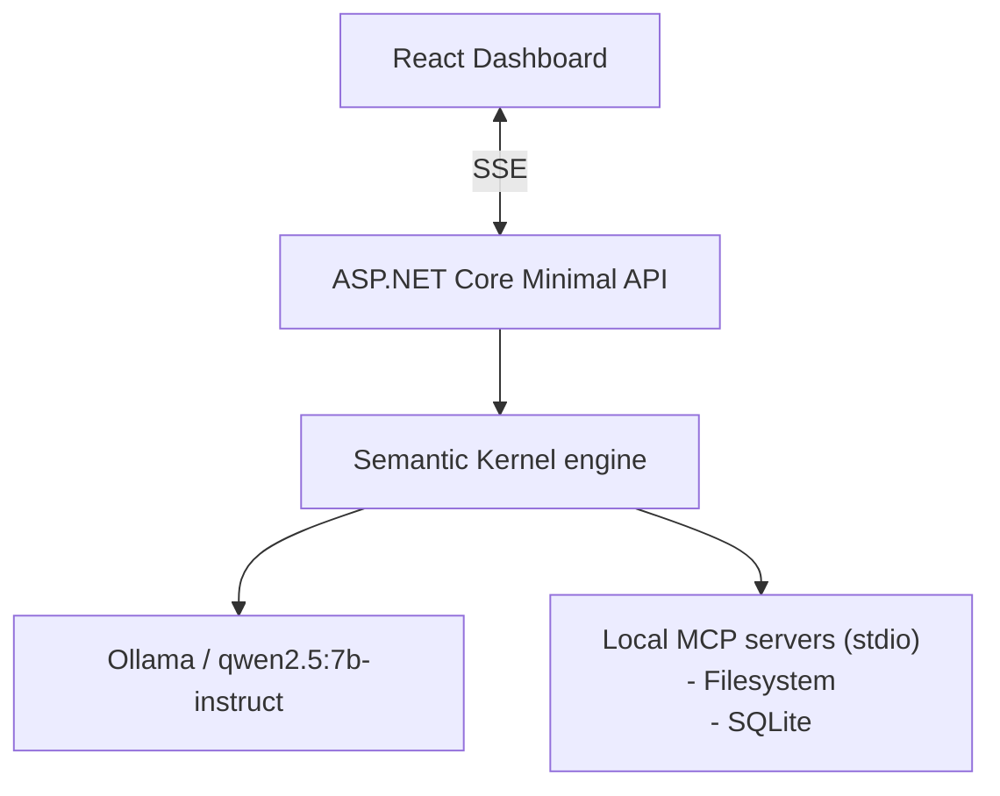

# Technical Architecture Document

**Project:** Local Knowledge & File Assistant
**Status:** Draft. Implemented through Phase 4.4 (streaming, MCP filesystem tools, ReAct loop with validation, metadata index, read-only SQLite MCP server, tool selection prompt). Items marked *(planned)* are design intent, not implemented.

## 1. Purpose and scope

Build a single-agent assistant that reasons over a user's local documents and metadata using a ReAct loop, entirely on local infrastructure (no cloud LLM).

**In scope:** ReAct loop, tool calling through local MCP servers, schema validation of tool I/O, token streaming to a web UI, dependency-injected layering.

**Out of scope:** multi-agent orchestration, authentication, multi-user hosting, persistence of conversations, remote/cloud models.

## 2. Context



Everything runs on one developer machine. The only network traffic is loopback.

## 3. Technology choices

| Concern | Choice | Rationale |
|---|---|---|
| Runtime | .NET 10 (`net10.0`) | Installed runtime; the brief said .NET 9, but no ASP.NET Core 9 runtime is present |
| API | ASP.NET Core Minimal API | Small surface, one streaming endpoint |
| Orchestration | Microsoft Semantic Kernel 1.81 | Function calling, plugin model, Ollama connector |
| LLM runtime | Ollama, `qwen2.5:7b-instruct` (fallback `llama3.2:3b`) | Local, open weights, supports tool calling |
| Tool protocol | Model Context Protocol, official C# SDK (`ModelContextProtocol` 2.2) | Standard stdio servers, no custom tool glue |
| Streaming | Server-Sent Events | One-way server-to-client stream is enough; simpler than SignalR |
| Frontend | React + TypeScript + Vite + Tailwind v4 | Per the brief |
| Tests | xUnit | Default for .NET |

## 4. Solution structure

```
src/Assistant.Core   Agent loop, LLM abstraction, tool registry, MCP wiring
src/Assistant.Api    Composition root, HTTP endpoints, SSE
tests/Assistant.Tests
web/                 React dashboard
docs/
```

Dependency direction: `Api -> Core`; `Tests -> Api, Core`. Core has no ASP.NET dependency, so the agent can be tested without HTTP.

## 5. Components

### 5.1 Agent runner (`Assistant.Core.Agent`)
`IAgentRunner.RunAsync(prompt, ct)` returns `IAsyncEnumerable<AgentEvent>`. The API depends only on this interface. The Semantic Kernel implementation owns the kernel, chat history and the ReAct loop.

Events:

| Event | Meaning |
|---|---|
| `TokenEvent(Text)` | Incremental model output |
| `ToolCallEvent(Tool, ArgumentsJson)` | Model requested a tool |
| `ToolResultEvent(Tool, Result, IsError)` | Tool output or validation failure |
| `ErrorEvent(Message)` | Run stopped abnormally (timeout or iteration cap); `DoneEvent` still follows |
| `DoneEvent` | Run finished |

### 5.2 ReAct loop
1. Append user message to chat history.
2. Stream a completion with tool calling enabled. Emit `TokenEvent`s.
3. If the model requests tools: validate each call (section 6), emit `ToolCallEvent`, invoke, emit `ToolResultEvent`, append the result to history, go to 2.
4. If the model returns a final answer: emit `DoneEvent`.
5. Guards (`Agent` config section): iteration cap (default 8), per-run timeout (120s), and a limit on identical repeated calls (default 2; further repeats return an error result instead of executing). Tool output over `MaxToolResultChars` is truncated with a marker.

Function invocation is driven manually rather than by Semantic Kernel's auto-invoke, so every call can be validated and surfaced to the UI.

### 5.3 Tool registry (`Assistant.Core.Tools`)
`IToolRegistry.RegisterAsync(kernel)` adds tools to a kernel. Implementations: MCP-backed tools (primary) and optionally native C# tools for testing.

### 5.4 MCP integration (`Assistant.Core.Mcp`)
`McpServerOptions` (config section `Mcp`) lists stdio servers as name, command and args. At startup each server is launched via the MCP C# SDK client, its tools are listed, and they are exposed to Semantic Kernel as functions. Initial servers:

- Filesystem MCP server, restricted to an allow-listed root directory.
- SQLite MCP server (`Assistant.SqliteMcp`, our own), pointed at the metadata database under `data/`. It was written rather than adopted because the available npm servers either let the model switch off read-only mode or choose the database file through tool arguments, or did not start through `npx`. It exposes two tools, `describe_schema` and `query`. The database path is fixed at launch. The guarantee is layered: the file is opened `Mode=ReadOnly` with `PRAGMA query_only`, so SQLite refuses every write; in front of that, only a single `SELECT`/`WITH` statement without comments is accepted; rows are capped and queries are interrupted after 5 seconds.

Server arguments may contain the token `{BaseDirectory}`, expanded to the app's base directory; this is how the API launches `Assistant.SqliteMcp.dll`, which is copied next to it by a project reference. That project targets the ASP.NET shared framework because it is run from the API's output folder, where only that framework supplies hosting.

A server that fails to start is logged and skipped; the app stays up without its tools.

**Tool selection.** The model sees seven tools: from the filesystem server, `list_allowed_directories`, `list_directory`, `search_files`, `read_text_file` and `read_multiple_files`; from SQLite, `describe_schema` and `query`. Each server's `ExcludeTools` withholds its write tools and the filesystem tools that duplicate the metadata index (`get_file_info`, `list_directory_with_sizes`, `directory_tree`) or are unhelpful to a text model (`read_file`, a deprecated alias, and `read_media_file`). Fewer, non-overlapping tools make selection easier for a 7B model. The system prompt (`Prompts/system.v2.md`) routes metadata questions to `query`, content questions to the read tools, and combined questions to a query first, whose `path` column is then read as-is. It also summarises the `files` table so the model can query without first calling `describe_schema`. For relative dates it uses `datetime(modified_utc)` against `datetime('now', ...)`, because the indexer's ISO timestamps do not compare correctly as raw text against SQLite's own format. When SQLite is unavailable, or the index lags behind the disk, the prompt falls back to listing and searching. Tests keep the prompt in step with the `files` columns and the excluded tool list.

Servers are long-lived child processes owned by a hosted service and disposed on shutdown.

### 5.5 Metadata index (`Assistant.Core.Indexing`)
A SQLite database (`data/assistant.db`) describes the files under the allow-listed root so metadata questions do not need every file read. The schema is `data/migrations/NNN_*.sql`, embedded in the assembly and applied in order by `MetadataDatabase.Migrate()`; the version is stored in SQLite's `user_version`. Tables: `files` (absolute path, name, extension, size, modified time, SHA-256), `tags` and `file_tags`, `summaries` (tied to the file hash they were written for). Tags and summaries are not populated yet.

`FileIndexer` is incremental. A file whose size and modified time are unchanged is not read; one whose time changed is re-hashed and counts as updated only if the hash differs. Rows for deleted files are removed and cascade to tags and summaries. A locked file is skipped and keeps its row. `IndexingService` runs a scan at startup and every `Indexing:IntervalMinutes` (config section `Indexing`: `Enabled`, `Root`, `DatabasePath`, `IntervalMinutes`). The indexer is the only writer, and the database uses WAL so the read-only server can query during a scan. `Indexing:Root` must be kept equal to the filesystem server's allow-listed root by hand.

### 5.6 API (`Assistant.Api`)
- `GET /api/health`
- `POST /api/chat` with body `{ "prompt": string }`. Responds `text/event-stream`; each frame is `event: <EventTypeName>` plus `data: <json>`.

### 5.7 Frontend (`web`)
`useAgentStream` posts the prompt with `fetch` and parses the SSE body incrementally (`EventSource` cannot send POST). Vite proxies `/api` to `http://localhost:5080` in development. UI components *(planned)*: message list with streamed text, collapsible tool-call/result cards, error banner.

## 6. Tool-call validation

Small local models emit malformed tool calls (wrong names, missing or mistyped arguments, invalid JSON). The runner must never crash or execute a bad call.

1. **Name check:** unknown tool, so return an error result listing valid tool names.
2. **Argument parse:** invalid JSON is an error result.
3. **Schema check:** validate arguments against the tool's JSON Schema (from the MCP tool definition). Failures return an error result naming the offending fields.
4. **Result check:** tool output is size-capped and truncated with a marker if over the limit.

Validation errors are fed back to the model as tool results with `IsError = true`, giving it a chance to self-correct within the iteration cap. They are also streamed to the UI.

## 7. Dependency injection

Composition happens only in `Assistant.Api/Program.cs`:

- `Kernel` with Ollama chat completion (endpoint and model from configuration)
- `IToolRegistry` (MCP-backed)
- `IAgentRunner` (Semantic Kernel implementation), scoped per request
- Hosted service managing MCP server processes (singleton lifetime)
- `McpServerOptions` bound from configuration

Endpoints resolve `IAgentRunner` only; they know nothing about Semantic Kernel or MCP.

## 8. Cross-cutting concerns

- **Streaming and cancellation:** the request `CancellationToken` flows through the runner to the model and tool calls; a client disconnect stops the run.
- **Security:** the filesystem server is limited to an allow-listed root; the API binds to loopback only; CORS allows only the Vite dev origin. File contents can contain prompt-injection text, so tools are read-only in v1.
- **Configuration:** `appsettings.json` for model name, Ollama URL, MCP servers, iteration cap and timeouts.
- **Observability:** structured logging of each tool call, validation failure and iteration count.

## 9. Testing strategy

- Unit: tool-call validation (valid, unknown tool, bad JSON, schema violation, oversize output).
- Unit: agent loop against a fake chat service that scripts tool calls, including malformed ones, and the iteration cap.
- Integration (opt-in, requires Ollama): end-to-end prompt that triggers a filesystem tool call.
- Frontend: SSE frame parsing in `useAgentStream`.

## 10. Roadmap

The phased delivery plan, with stages and exit criteria, is maintained in [ROADMAP.md](ROADMAP.md).

## 11. Risks and open questions

| Risk | Mitigation |
|---|---|
| 7B model unreliable at tool calling | Strict validation with error feedback; try `llama3.2:3b` and larger Qwen variants |
| Semantic Kernel Ollama connector is prerelease | Isolated behind `IAgentRunner`; can swap to `Microsoft.Extensions.AI` |
| MCP SDK API churn (2.x) | Wrap client usage in `Assistant.Core.Mcp` only |
| Prompt injection via file contents | Read-only tools, allow-listed root, show all tool activity in the UI |
| Context window limits with large files | Output size caps; chunked reads |
| Open: SSE vs SignalR | SSE chosen for simplicity; revisit if bidirectional control (e.g. cancel, approve tool) is needed |
